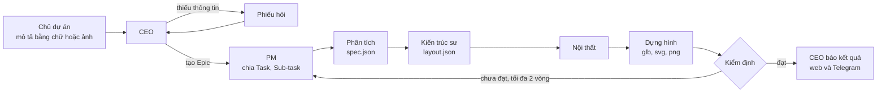

# Studio Nhà 3D

**Công ty AI gồm 7 agent, biến mô tả bằng chữ hoặc ảnh thành mô hình nhà 3D xem ngay trên trình duyệt.**

> [!IMPORTANT]
> **Dự án này được phát triển từ [Paperclip](https://github.com/paperclipai/paperclip)**, nền tảng mã nguồn mở (giấy phép MIT) để vận hành công ty gồm nhiều AI agent.
>
> Nhóm không viết lại nền tảng. Kho này lấy mã nguồn Paperclip tại commit [`3659a3a947`](https://github.com/paperclipai/paperclip/commit/3659a3a947) làm nền, rồi xây thêm công ty Studio Nhà 3D, bộ dựng nhà, trình xem 3D và các phần mở rộng.
>
> Đây là bài tập lớn môn Quản lý dự án phần mềm, không phải bản phát hành chính thức của Paperclip.

## Mục lục

- [Giới thiệu](#giới-thiệu)
- [Phần kế thừa từ Paperclip và phần nhóm phát triển](#phần-kế-thừa-từ-paperclip-và-phần-nhóm-phát-triển)
- [Tổ chức công ty AI](#tổ-chức-công-ty-ai)
- [Quy trình hoạt động](#quy-trình-hoạt-động)
- [Chức năng chính](#chức-năng-chính)
- [Công nghệ sử dụng](#công-nghệ-sử-dụng)
- [Cài đặt bằng Docker](#cài-đặt-bằng-docker)
- [Thiết lập lần đầu](#thiết-lập-lần-đầu)
- [Sử dụng](#sử-dụng)
- [Kết nối Telegram (không bắt buộc)](#kết-nối-telegram-không-bắt-buộc)
- [Vận hành và sao lưu](#vận-hành-và-sao-lưu)
- [Xử lý lỗi thường gặp](#xử-lý-lỗi-thường-gặp)
- [Cấu trúc thư mục](#cấu-trúc-thư-mục)
- [Chạy thử bộ dựng nhà](#chạy-thử-bộ-dựng-nhà)
- [Giới hạn hiện tại](#giới-hạn-hiện-tại)
- [Giấy phép và ghi công](#giấy-phép-và-ghi-công)

## Giới thiệu

Người dùng đóng vai **chủ dự án**: chỉ cần mô tả ngôi nhà mong muốn. Bảy agent tự hỏi lại khi thiếu thông tin, lập kế hoạch, thiết kế, dựng hình và kiểm định, giống một công ty thiết kế thu nhỏ.

Mỗi căn nhà hoàn thành có bốn sản phẩm:

| File | Nội dung |
| --- | --- |
| `<ten-san-pham>.glb` | Mô hình 3D: sàn, tường, cửa, cầu thang, mái, nội thất, sân vườn |
| `plan.svg` | Bản vẽ mặt bằng các tầng |
| `iso.svg` | Hình phối cảnh |
| `render.png` | Ảnh phối cảnh dựng bằng Blender Cycles |

Nguyên tắc thiết kế: **agent quyết định thiết kế, chương trình quyết định hình học.** Agent chỉ viết file JSON mô tả phòng, cửa, mái và nội thất. Bộ dựng Python kiểm tra rồi sinh mô hình. Nhờ vậy kết quả ổn định và một lỗi chỉ cần sửa một lần cho mọi căn nhà.

## Phần kế thừa từ Paperclip và phần nhóm phát triển

| Hạng mục | Paperclip cung cấp | Nhóm phát triển thêm hoặc chỉnh sửa |
| --- | --- | --- |
| Điều phối agent | Công ty, agent, đánh thức agent, lịch sử chạy, phân quyền | Công ty 7 agent kèm hướng dẫn và skill, tự tạo khi cài mới |
| Công việc | Task, bình luận, file đính kèm, phiếu hỏi, quan hệ chặn | Cây 4 cấp Yêu cầu → Epic → Task → Sub-task, story point |
| Dựng nhà 3D | Không có | Bộ dựng `house_builder.py`, render Blender, schema `spec.json` và `layout.json` |
| Xem mô hình | Khung xem file đính kèm | Trình xem `.glb`: tách tầng, đo, đi dạo, đổi màu, vật liệu, ánh sáng |
| Quản lý sản phẩm | Lưu file đính kèm | Tab Files của dự án, ghi đè file trùng tên nhưng giữ nguyên liên kết |
| Thống kê | Nhật ký và chi phí | Trang Agent Stats, theo dõi hạn mức tài khoản AI |
| Agent Office | Hệ thống plugin | Tuỳ chỉnh plugin Agent Pixels: bố cục, ánh sáng, phòng họp, góc nhìn 3D |
| Telegram | Hệ thống plugin | Tuỳ chỉnh plugin `paperclip-plugin-telegram`: trả lời phiếu hỏi bằng nút, tự gửi thành phẩm |
| Triển khai | Dockerfile, Docker Compose | Đóng gói Blender, công ty mẫu và hai plugin vào image |

Lịch sử Git tách rõ hai phần. Commit `29ac85815e` là mã nguồn Paperclip gốc. Xem toàn bộ phần nhóm thay đổi:

```sh
git diff --stat 29ac85815e main
```

Tài liệu của nền tảng gốc: [README của Paperclip](https://github.com/paperclipai/paperclip#readme) và thư mục [`doc/`](doc/).

## Tổ chức công ty AI

```text
Chủ dự án (người dùng)
└── CEO                   tiếp nhận yêu cầu, gửi phiếu hỏi, báo kết quả
    └── PM                lập kế hoạch, chia Epic thành Task và Sub-task
        ├── Phân tích     chữ hoặc ảnh → spec.json
        ├── Kiến trúc sư  spec.json → layout.json
        ├── Nội thất      xếp đồ vào layout.json
        ├── Dựng hình     layout.json → .glb, plan.svg, iso.svg, render.png
        └── Kiểm định     nghiệm thu: Đạt hoặc trả về sửa
```

| Agent | Đầu vào | Đầu ra | AI mặc định khi cài mới |
| --- | --- | --- | --- |
| CEO | Yêu cầu của chủ dự án | Phiếu hỏi, một Epic cho mỗi nhà, lời báo kết quả | Codex |
| PM | Epic | Cây Task, Sub-task và quan hệ chặn | Codex |
| Phân tích | Yêu cầu và câu trả lời | `spec.json` | Claude |
| Kiến trúc sư | `spec.json` | `layout.json` | Claude |
| Nội thất | `layout.json` | `layout.json` có nội thất | Claude |
| Dựng hình | `layout.json` cuối | `.glb`, `plan.svg`, `iso.svg`, `render.png` | Codex |
| Kiểm định | Toàn bộ file | Biên bản nghiệm thu | Claude |

Có thể đổi nhà cung cấp và mô hình của từng agent trong giao diện, không cần sửa mã nguồn.

## Quy trình hoạt động



1. Chủ dự án tạo task và giao cho CEO.
2. Nếu yêu cầu còn thiếu, CEO gửi phiếu hỏi có sẵn lựa chọn.
3. CEO tạo một Epic và giao PM. PM chia thành Task, Sub-task và khai báo việc nào chặn việc nào.
4. Các agent làm theo thứ tự phụ thuộc, có bước xem chéo để phát hiện lỗi sớm.
5. Kiểm định nghiệm thu. PM giao mục chưa đạt lại cho đúng agent phụ trách, tối đa hai vòng.
6. CEO báo kết quả. Nếu đã kết nối Telegram, sản phẩm được gửi về điện thoại.

## Chức năng chính

- **Tiếp nhận yêu cầu** bằng chữ hoặc ảnh, có phiếu hỏi khi thiếu thông tin.
- **Quản lý công việc 4 cấp**: trạng thái, độ ưu tiên, story point, quan hệ chặn, người phụ trách.
- **Trình xem nhà 3D**: xoay, phóng, tách tầng, ẩn hiện bộ phận, đo khoảng cách, đi dạo bên trong, chụp ảnh, đổi và lưu bảng màu.
- **Tab Files**: gom phiên bản mới nhất của các file trong dự án.
- **Agent Stats**: thống kê lượt chạy theo agent, dự án, Epic và hạn mức tài khoản AI.
- **Agent Office**: văn phòng pixel, mỗi agent là một nhân vật.
- **Telegram hai chiều**: nhận thông báo, trả lời phiếu hỏi bằng nút, nhận ảnh và mô hình thành phẩm.

## Công nghệ sử dụng

| Nhóm | Công nghệ |
| --- | --- |
| Nền tảng | **Paperclip** (commit `3659a3a947`) |
| Máy chủ | Node.js, TypeScript, Express, Drizzle ORM, PostgreSQL nhúng, Better Auth |
| Giao diện | React, Vite, Tailwind CSS, Three.js |
| Dựng nhà | Python 3 (chỉ dùng thư viện chuẩn), Blender 4.5.17 LTS |
| AI | Claude (Anthropic), Codex (OpenAI) |
| Kiểm thử | Vitest, `node --test`, lệnh `selftest` của bộ dựng |
| Triển khai | Docker, Docker Compose |

## Cài đặt bằng Docker

### 1. Chuẩn bị

| Yêu cầu | Ghi chú |
| --- | --- |
| [Git](https://git-scm.com/downloads) | Để tải mã nguồn |
| [Docker Desktop](https://www.docker.com/products/docker-desktop/) | Đã gồm Docker Compose. Trên Windows nên dùng nền WSL 2 |
| Ổ đĩa trống | Image sau khi build khoảng 12 GB, nên để trống từ 30 GB |
| Internet | Lần build đầu tải các gói phụ thuộc và Blender |
| Tài khoản AI | Tài khoản Claude và Codex, hoặc API key của Anthropic và OpenAI |

Không cần cài Node.js, Python, PostgreSQL hay Blender trên máy. Tất cả nằm trong container.

### 2. Tải mã nguồn

**Windows (PowerShell):**

```powershell
git clone -c core.autocrlf=false -c core.longpaths=true https://github.com/DoanNgocQuang/House-Design.git
cd House-Design
```

**Linux hoặc macOS:**

```sh
git clone https://github.com/DoanNgocQuang/House-Design.git
cd House-Design
```

> [!WARNING]
> Trên Windows phải giữ `core.autocrlf=false`. Nếu Git đổi xuống dòng sang CRLF, mã băm của các file migration sẽ sai và hệ thống có thể không build hoặc không khởi động được.

### 3. Tạo file `docker/.env`

File này chứa hai chuỗi bí mật ngẫu nhiên, **khác nhau**. Chỉ tạo một lần rồi giữ nguyên cho những lần chạy sau. Chạy lệnh ở thư mục gốc của dự án.

**Windows (PowerShell):**

```powershell
function New-Secret { $b = New-Object byte[] 32; [Security.Cryptography.RandomNumberGenerator]::Create().GetBytes($b); -join ($b | ForEach-Object { $_.ToString('x2') }) }
"BETTER_AUTH_SECRET=$(New-Secret)", "PAPERCLIP_TOOL_ACTION_SIGNING_SECRET=$(New-Secret)" | Set-Content -Encoding ascii docker\.env
```

**Linux hoặc macOS:**

```sh
printf 'BETTER_AUTH_SECRET=%s\nPAPERCLIP_TOOL_ACTION_SIGNING_SECRET=%s\n' "$(openssl rand -hex 32)" "$(openssl rand -hex 32)" > docker/.env
```

Các biến dùng được trong `docker/.env`:

| Biến | Bắt buộc | Mặc định | Ý nghĩa |
| --- | --- | --- | --- |
| `BETTER_AUTH_SECRET` | Có | Không có | Ký phiên đăng nhập |
| `PAPERCLIP_TOOL_ACTION_SIGNING_SECRET` | Nên có | Trống | Ký các thao tác cần phê duyệt |
| `ANTHROPIC_API_KEY` | Không | Trống | API key của Anthropic |
| `OPENAI_API_KEY` | Không | Trống | API key của OpenAI |
| `PAPERCLIP_PORT` | Không | `3100` | Cổng trên máy |
| `PAPERCLIP_PUBLIC_URL` | Không | `http://localhost:3100` | Địa chỉ người dùng mở. Đổi cổng thì đổi cả biến này |
| `PAPERCLIP_ALLOWED_HOSTNAMES` | Không | Trống | Tên máy khác được phép truy cập, cách nhau bằng dấu phẩy |
| `PAPERCLIP_DATA_DIR` | Không | `../data/docker-paperclip` | Nơi lưu dữ liệu |

> [!CAUTION]
> Không commit `docker/.env`. File này đã nằm trong `.gitignore`.

### 4. Build và chạy

```sh
cd docker
docker compose -f docker-compose.quickstart.yml up -d --build
```

Lần đầu mất khá lâu vì phải build mã nguồn và tải Blender. Các lần sau nhanh hơn nhờ cache.

### 5. Kiểm tra

```sh
docker compose -f docker-compose.quickstart.yml ps
docker compose -f docker-compose.quickstart.yml logs -f
```

Mở <http://localhost:3100/api/health>. Kết quả có `"status":"ok"` nghĩa là máy chủ đã hoạt động. Giao diện nằm ở <http://localhost:3100>.

## Thiết lập lần đầu

1. Mở <http://localhost:3100>, chọn **Sign in / Create account** và tạo tài khoản.
2. Bấm **Claim this instance** để nhận quyền quản trị.
3. Công ty **Studio Nhà 3D** được tạo tự động với 7 agent, hướng dẫn và skill. Hai plugin Agent Office và Telegram cũng được cài sẵn.
4. Mở **Connectors** ở thanh bên, kết nối tài khoản Claude và Codex.
5. Mở **Agents**, vào từng agent và chọn tài khoản AI cùng mô hình. Nếu chỉ có một nhà cung cấp, đổi cả 7 agent sang nhà cung cấp đó.
6. Tạo một project, ví dụ `Thiết kế nhà`.

Công ty mẫu chỉ được tạo **một lần** cho mỗi bộ dữ liệu.

## Sử dụng

1. Trong project, tạo task mới và giao cho **CEO**. Ví dụ:

   > Thiết kế nhà phố 2 tầng, lô đất 5 × 18 m, 3 phòng ngủ, mái Thái, có sân trước để xe và một khoảng cây xanh.

2. Nếu CEO gửi phiếu hỏi, chọn câu trả lời ngay trong task.
3. Theo dõi tiến độ ở **Tasks**, **Agent Stats** hoặc **Agent Office**.
4. Mở file `.glb` trong task hoặc trong tab **Files** của project để xem nhà 3D.
5. Muốn sửa, bình luận vào task. Muốn đổi màu, đổi trực tiếp trong trình xem rồi lưu bảng màu.

## Kết nối Telegram (không bắt buộc)

1. Tạo bot bằng [@BotFather](https://t.me/BotFather) và lấy token.
2. Trong Paperclip, mở trang cài đặt plugin **Telegram** và lưu token dưới dạng secret.
3. Ở mục **Board Access Connection**, cấp quyền để bot trả lời phiếu hỏi thay bạn.
4. Điền **Fallback Chat ID**, **Allowed Telegram user IDs** và **Allowed Telegram chat IDs**. Dùng các ID này để giới hạn ai được điều khiển bot và nhận file.
5. Bật **Enable bot commands** và **Enable inbound replies**, rồi gõ `/status` cho bot để thử.

Nếu `PAPERCLIP_PUBLIC_URL` là `localhost`, các liên kết trong tin nhắn không mở được trên điện thoại.

## Vận hành và sao lưu

Chạy các lệnh sau trong thư mục `docker`.

| Việc | Lệnh |
| --- | --- |
| Xem nhật ký | `docker compose -f docker-compose.quickstart.yml logs -f` |
| Dừng | `docker compose -f docker-compose.quickstart.yml stop` |
| Chạy lại | `docker compose -f docker-compose.quickstart.yml start` |
| Cập nhật sau `git pull` | `docker compose -f docker-compose.quickstart.yml up -d --build` |
| Gỡ container, giữ dữ liệu | `docker compose -f docker-compose.quickstart.yml down` |

Dữ liệu nằm ở `data/docker-paperclip`, ngoài container, nên build lại không mất dữ liệu. Để sao lưu, dừng container rồi sao chép thư mục này cùng file `docker/.env`.

## Xử lý lỗi thường gặp

| Hiện tượng | Cách xử lý |
| --- | --- |
| `BETTER_AUTH_SECRET must be set` | Chưa có `docker/.env`, hoặc đang chạy lệnh ngoài thư mục `docker` |
| `Filename too long` khi clone | Clone lại với `-c core.longpaths=true` |
| Lỗi mã băm migration, hoặc build báo file sinh tự động bị lệch | Có thể mã nguồn bị đổi sang CRLF. Clone lại với `-c core.autocrlf=false` |
| Cổng 3100 đang bận | Đặt `PAPERCLIP_PORT` và `PAPERCLIP_PUBLIC_URL` trong `docker/.env` |
| Build dừng vì hết ổ đĩa | Giải phóng ổ đĩa, hoặc tăng giới hạn ổ đĩa của Docker Desktop |
| Agent báo lỗi ngay khi chạy | Kiểm tra tài khoản AI của agent, hạn mức và tên mô hình |
| Không vào được từ máy khác | Thêm tên máy vào `PAPERCLIP_ALLOWED_HOSTNAMES` và đặt lại `PAPERCLIP_PUBLIC_URL` |
| Xuất hiện thư mục `shop online` cạnh thư mục dự án | Do dòng mount `../../shop online:/workspace/shop-online` trong file Compose. Không dùng thì xoá dòng này |

## Cấu trúc thư mục

```text
House-Design/
├── integrations/
│   ├── studio-nha-3d/             ★ công ty AI của nhóm
│   │   ├── agents/                hướng dẫn của 7 agent
│   │   └── skills/
│   │       ├── chon-kieu-nha/     phiếu hỏi của CEO
│   │       ├── house-builder/     bộ dựng Python, render Blender, nội thất, nhà mẫu
│   │       ├── kien-truc-nha-o/   schema, kích thước chuẩn, checklist
│   │       ├── qa-acceptance/     skill nghiệm thu (từ Paperclip)
│   │       └── task-planning/     skill lập kế hoạch (từ Paperclip)
│   ├── agent-pixels/              ★ plugin Agent Office đã tuỳ chỉnh
│   ├── telegram/                  ★ plugin Telegram đã tuỳ chỉnh
│   └── workspace-plugins/         ★ build và khôi phục hai plugin
├── server/                        máy chủ Paperclip, có phần bổ sung của nhóm
├── ui/                            giao diện Paperclip, thêm trình xem 3D và Agent Stats
├── packages/                      các gói dùng chung của Paperclip
├── docker/                        cấu hình Docker Compose
├── doc/, docs/                    tài liệu của Paperclip
└── Dockerfile                     image gồm máy chủ, Blender và công ty mẫu
```

★ là thư mục nhóm thêm vào. Các thư mục còn lại thuộc nền tảng Paperclip.

## Chạy thử bộ dựng nhà

Bộ dựng chỉ cần Python 3, chạy được mà không cần Docker. Kiểm tra bộ dựng:

```sh
python integrations/studio-nha-3d/skills/house-builder/scripts/house_builder.py selftest
```

Dựng một căn nhà mẫu, kết quả nằm trong thư mục `ket-qua`:

```sh
python integrations/studio-nha-3d/skills/house-builder/scripts/house_builder.py build integrations/studio-nha-3d/skills/house-builder/examples/nha-pho-mai-thai.json --out ket-qua
```

Các mẫu khác nằm trong [`examples/`](integrations/studio-nha-3d/skills/house-builder/examples/).

## Giới hạn hiện tại

- Hình học chủ yếu dựng từ các khối đơn giản và thư viện nội thất có sẵn, nên chưa phù hợp với kiến trúc phức tạp.
- Render bằng CPU nên mỗi ảnh mất vài phút.
- Sản phẩm phục vụ lên ý tưởng và học tập, không thay thế hồ sơ thiết kế, tính toán kết cấu hay giấy phép xây dựng.
- Chất lượng và tốc độ phụ thuộc vào mô hình AI và hạn mức tài khoản.

## Giấy phép và ghi công

Kho này giữ nguyên [giấy phép MIT](LICENSE) của Paperclip, © 2025 Paperclip AI.

| Thành phần | Nguồn | Giấy phép |
| --- | --- | --- |
| Nền tảng | [Paperclip](https://github.com/paperclipai/paperclip) | MIT |
| Plugin Agent Office | [tomartec/pixel-agent](https://github.com/tomartec/pixel-agent), bắt nguồn từ [gcampton/Agent-Pixels](https://github.com/gcampton/Agent-Pixels) | MIT |
| Plugin Telegram | [paperclip-plugin-telegram](https://www.npmjs.com/package/paperclip-plugin-telegram) | MIT |
| Mô hình nội thất | [Kenney Furniture Kit](https://kenney.nl) | CC0 |
| Texture và bầu trời HDR | [Poly Haven](https://polyhaven.com) | CC0 |

Cảm ơn nhóm Paperclip và các tác giả mã nguồn mở. Các thay đổi trong kho này do nhóm chịu trách nhiệm, vui lòng không báo lỗi của Studio Nhà 3D cho Paperclip.
